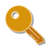
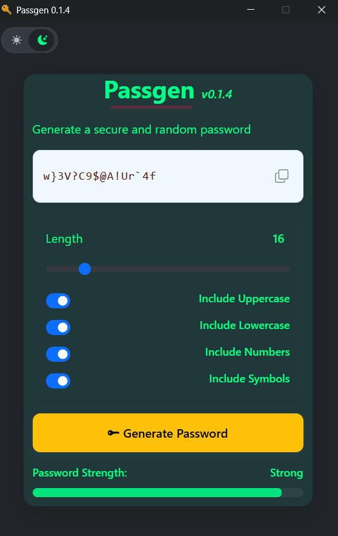

<p align="center">
  
</p>

# Passgen

<p align="center">
  
  
  
  
  
</p>

A lightweight desktop password generator built with [Neutralino.js](https://neutralino.js.org/) and Bootstrap.

Passgen lets you generate random passwords using the Web Crypto API, with a custom length and a choice of character sets, then copies them to your clipboard with a single click or keystroke.

## Clone

```bash
git clone https://github.com/dnihs/passgen-app.git
cd passgen-app
```

## Running from source

This app runs on the Neutralino CLI.

```bash
npm install -g @neutralinojs/neu
neu update
neu run
```

## Using a release build

Releases ship as a Neutralino distribution with 7 files covering all supported platforms:

| File | Platform |
|---|---|
| `Passgen-linux_x64` | Linux, 64-bit |
| `Passgen-linux_arm64` | Linux, ARM 64-bit |
| `Passgen-linux_armhf` | Linux, ARM 32-bit |
| `Passgen-mac_x64` | macOS, Intel |
| `Passgen-mac_arm64` | macOS, Apple Silicon |
| `Passgen-mac_universal` | macOS, universal |
| `Passgen-win_x64.exe` | Windows, 64-bit |

Download the binary for your platform from the Releases page.

### Linux

Open a terminal in the folder where you downloaded the file. For example:

```bash
cd ~/Downloads
chmod +x Passgen-linux_x64
./Passgen-linux_x64
```

If you downloaded `Passgen-linux_arm64` or `Passgen-linux_armhf`, replace the file name in the commands above.

### macOS

Open a terminal in the folder where you downloaded the file. For example:

```bash
cd ~/Downloads
chmod +x Passgen-mac_x64
./Passgen-mac_x64
```

If you downloaded `Passgen-mac_arm64` or `Passgen-mac_universal`, replace the file name in the commands above.

If macOS blocks the binary, Control-click it and choose Open. You can also remove the quarantine flag:

```bash
xattr -d com.apple.quarantine Passgen-mac_x64
```

### Windows

Double-click `Passgen-win_x64.exe`.

If Windows SmartScreen shows a warning, select `More info`, then choose `Run anyway`.

------

## Preview

<p align="center">    </p>

------

## Options

- **Length**: 8 to 64 characters, adjustable with the slider
- **Include Uppercase**: A to Z
- **Include Lowercase**: a to z
- **Include Numbers**: 0 to 9
- **Include Symbols**: `!@#$%^&*()-_=+[]{}/|;:,.<>` and others

At least one character type must be selected to generate a password.

A strength meter (Weak / Medium / Strong) updates after each generation, based on password length and the variety of character types used.

## Keyboard shortcuts

| Key | Action |
|---|---|
| `Space` | Generate a new password |
| `C` or `Ctrl+C` | Copy the current password to clipboard |

## Build info

- Application ID: `com.dnihs.passgen`
- Built with Neutralino.js 6.9.0

## Credits

- Desktop packaging: [Neutralino.js](https://neutralino.js.org/) ([GitHub](https://github.com/neutralinojs/neutralinojs)), MIT License
- UI framework: [Bootstrap](https://getbootstrap.com) ([GitHub](https://github.com/twbs/bootstrap)), MIT License
- App icon: [Key-security icon](https://icons8.com/icon/VpK0O12VDPoF/key-security) by [Icons8](https://icons8.com). Used under Icons8's free license, which requires linking back to icons8.com. This README serves as that attribution.

## License

This project is licensed under the [MIT License](LICENSE).

Copyright (c) 2026 [dnihs](https://github.com/dnihs).